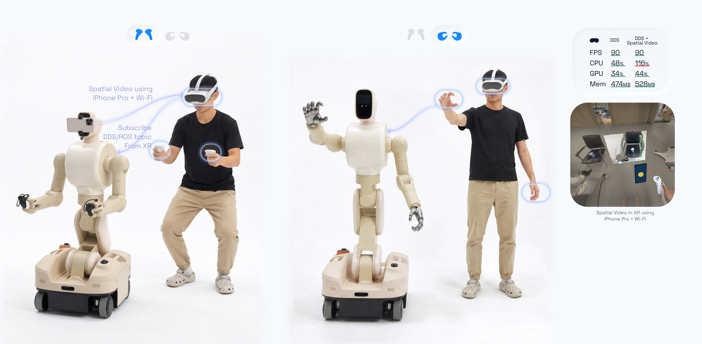
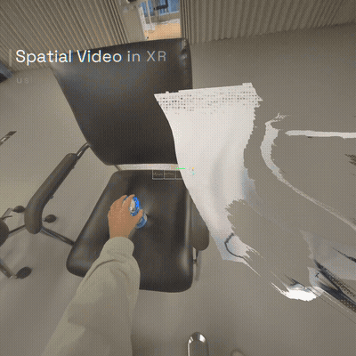
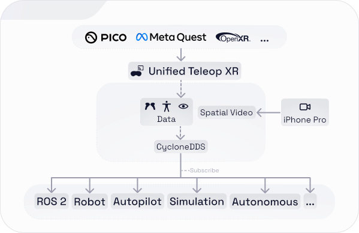
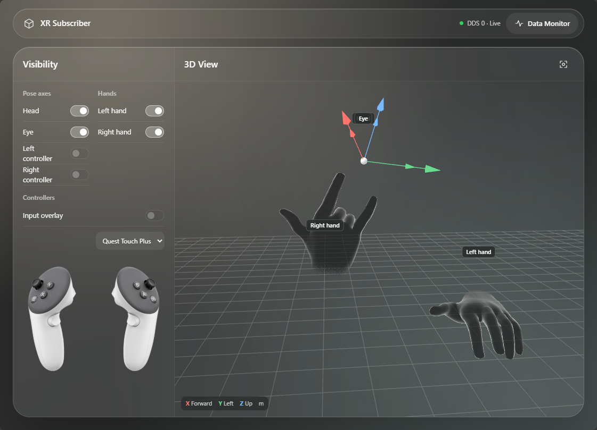
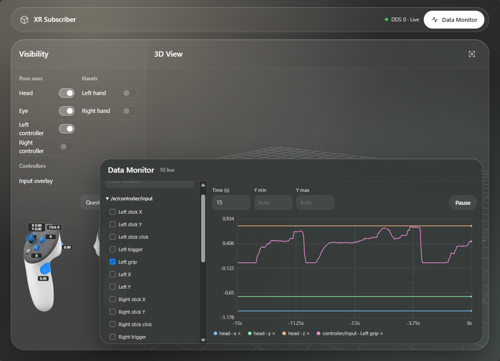

<div align="center">


**Turn your XR headset into a motion input device.**

Stream head, eye, hands, controllers, and body-tracking data from Meta Quest and PICO directly to ROS 2 over CycloneDDS — without building your own Unity application.

<kbd>OpenXR</kbd> <kbd>CycloneDDS</kbd> <kbd>ROS 2</kbd> <kbd>Unity</kbd>

<table align="center">
  <tr>
    <td></td>
    <td></td>
  </tr>
</table>

<p>
  <a href="#quick-start">Quick Start ↗</a> ·
  <a href="#architecture">Architecture ↗</a> ·
  <a href="#data">Data &amp; Topics ↗</a> ·
  <a href="#gpu-reconstructed-spatial-video">Spatial Video ↗</a> ·
  <a href="#supported-devices">Devices ↗</a> ·
  <a href="./README_CN.md">中文 ↗</a>
</p>
</div>

> The XR → CycloneDDS → ROS 2 path has been validated with a CycloneDDS-based ROS 2 receiver. Stable standalone APK releases for Meta Quest and PICO are planned. UTXR (Unified Teleop XR) is an open-source Unity toolkit that enables developers to stream tracked motion data to ROS2 systems with minimal setup. It streams pose, velocity, and interaction data using OpenXR and CycloneDDS. It has been used for robot teleoperation, robotic-arm manipulation, remote assistance, HRI research, egocentric data collection, and deep-learning workflows.

<a id="quick-start"></a>
## Quick Start

1. Install the **Meta Quest** or **PICO** APK from this repository's **Releases**.
2. Launch **Unified Teleop XR** on the headset.
3. Connect the headset and ROS 2/DDS receiver to the same reachable network. DDS discovery and traffic must be permitted by your network configuration.
4. Fill in the subscriber IPV4 in Unified Teleop XR app, toggle on the **Data Publish**.
5. In your subscriber device, discover and subscribe to XR topics.


<details>
<summary>Example commands on a ROS 2 system</summary>

ROS 2 system with `rmw_cyclonedds_cpp` installed:

```bash
export RMW_IMPLEMENTATION=rmw_cyclonedds_cpp

ros2 topic list
ros2 topic echo /xr/head/pose
```

**If you cannot see the topics:** Ensure the headset and receiver are on the same local network with multicast enabled, and verify that `rmw_cyclonedds_cpp` is configured.

</details>

<a id="why-unified-teleop-xr"></a>
## Why Unified Teleop XR?

Robot developers should not need to build a Unity project just to read a headset's pose, controllers, or tracked body data.

| You want to… | UTXR is designed to… |
| --- | --- |
| Get XR tracking into ROS 2 | Publish subscribable XR topic streams from the headset |
| Skip XR app development | Let receivers use a prebuilt Quest/PICO APK rather than a Unity project |
| Avoid a separate ROS–TCP bridge | Publish with CycloneDDS directly in the verified setup |
| Reuse a robot-side input pipeline | Keep topic structure consistent across supported devices, subject to available sensors |
| Handle imperfect tracking more deliberately | Expose tracking validity and offer optional Safeguard post-processing |

No Unity editor, ROS–TCP bridge, or custom ROS 2 packages required. The receiver only needs standard ROS 2 message packages:
- `builtin_interfaces`
- `geometry_msgs`
- `sensor_msgs`
- `std_msgs`

<a id="architecture"></a>
## How It Works

A robot, ROS 2 node, simulator, or native DDS application on the same network can subscribe to the published data directly.



<a id="data--topics"></a>
## Data

### Raw Output

<details>
<summary><b>Head Tracking</b></summary>

<pre>
/xr/head/pose                                 geometry_msgs/msg/PoseStamped
/xr/head/velocity                             geometry_msgs/msg/TwistStamped
/xr/head/tracking_state                       std_msgs/msg/UInt32
</pre>

</details>

<details>
<summary><b>Eye Tracking</b></summary>

<pre>
/xr/eye/pose                                  geometry_msgs/msg/PoseStamped
/xr/eye/tracking_state                        std_msgs/msg/UInt32
</pre>

</details>

<details>
<summary><b>Controller Tracking (Controller Mode Only)</b></summary>

<pre>
/xr/left/controller_pose                      geometry_msgs/msg/PoseStamped
/xr/left/controller_velocity                  geometry_msgs/msg/TwistStamped
/xr/left/controller_tracking_state            std_msgs/msg/UInt32
/xr/right/controller_pose                     geometry_msgs/msg/PoseStamped
/xr/right/controller_velocity                 geometry_msgs/msg/TwistStamped
/xr/right/controller_tracking_state           std_msgs/msg/UInt32
</pre>

</details>

<details>
<summary><b>Controller Joy (Controller Mode Only)</b></summary>

<pre>
/xr/controller/input                          sensor_msgs/msg/Joy
</pre>
`axes`: 8 float32 values.
<pre>
/xr/controller/input/axes[0]                  Left stick X
/xr/controller/input/axes[1]                  Left stick Y
/xr/controller/input/axes[2]                  Left trigger
/xr/controller/input/axes[3]                  Left grip
/xr/controller/input/axes[4]                  Right stick X
/xr/controller/input/axes[5]                  Right stick Y
/xr/controller/input/axes[6]                  Right trigger
/xr/controller/input/axes[7]                  Right grip
</pre>
`buttons`: 6 int32 values, `1` held and `0` released. Joy publishes when at least one input is available. Unavailable slots retain their zero defaults.
<pre>
/xr/controller/input/buttons[0]               X (left primary button)
/xr/controller/input/buttons[1]               Y (left secondary button)
/xr/controller/input/buttons[2]               A (right primary button)
/xr/controller/input/buttons[3]               B (right secondary button)
/xr/controller/input/buttons[4]               Left stick click
/xr/controller/input/buttons[5]               Right stick click
</pre>


</details>

<details>
<summary><b>Hand (Hand Mode Only)</b></summary>

<pre>
/xr/left/hand_joints                          std_msgs/msg/Float32MultiArray
/xr/left/hand_velocity                        geometry_msgs/msg/TwistStamped
/xr/left/hand_tracking_state                  std_msgs/msg/UInt32
/xr/right/hand_joints                         std_msgs/msg/Float32MultiArray
/xr/right/hand_velocity                       geometry_msgs/msg/TwistStamped
/xr/right/hand_tracking_state                 std_msgs/msg/UInt32
</pre>

208 float32 values per hand: 26 joint records only. Left hand shown; replace `left` with `right` for the right hand.

<pre>
/xr/left/hand_joints/data[0]                      Wrist tracking state
/xr/left/hand_joints/data[1]                      Wrist position x
/xr/left/hand_joints/data[2]                      Wrist position y
/xr/left/hand_joints/data[3]                      Wrist position z
/xr/left/hand_joints/data[4]                      Wrist orientation qx
/xr/left/hand_joints/data[5]                      Wrist orientation qy
/xr/left/hand_joints/data[6]                      Wrist orientation qz
/xr/left/hand_joints/data[7]                      Wrist orientation qw
</pre>

Each joint uses 8 values: `tracking state, x, y, z, qx, qy, qz, qw`. Joint i starts at `data[8*i]`.

<pre>
i = 0                                            Wrist
i = 1                                            Palm
i = 2…5                                          Thumb
i = 6…10                                         Index
i = 11…15                                        Middle
i = 16…20                                        Ring
i = 21…25                                        Little
</pre>

Finger order: Metacarpal, Proximal, Intermediate, Distal, Tip; Thumb has no Intermediate. The joint-state Pose bit is `2`; invalid poses are zeroed. Arrays have no timestamp.

Whole-hand flags are sent separately in `hand_tracking_state/data`. Linear and angular velocity are sent in the separate `hand_velocity/twist/linear` and `hand_velocity/twist/angular` fields. Velocity-validity bits are sampled only when hand velocity is enabled.

</details>

<details>
<summary><b>Body Tracking</b></summary>

To be done

</details>

<details>
<summary>Other details</summary>

Messages with a Header use `frame_id = xr_tracking`. Coordinates are converted to X-forward, Y-left, Z-up; positions are in meters.

`tracking_state.data` retains Unity's `InputTrackingState` bits: position `1`, rotation `2`, linear velocity `4`, angular velocity `8`, linear acceleration `16`, angular acceleration `32`. Pose requires both position and rotation; velocity requires both linear and angular velocity. Messages with unavailable inputs are skipped.

QoS: poses, velocities and joint arrays use BestEffort / Volatile / KeepLast(1); tracking state uses Reliable / TransientLocal / KeepLast(1); Joy uses Reliable / Volatile / KeepLast(10).

</details>

<div style="display:flex; gap:10px;">
  
  
</div>

The two figures show the [XR Subscriber](./CycloneDDS/subscriber/) interface when receiving dds messages from UTXR. This tool is made to debug and implemented a custom method to subscribe via c-plugin.

**Controller and Hand tracking are mutually exclusive.** Head and eye topics are shared. Changing mode stops publishing; restart manually.

### Safeguard Mode

Safeguard mode applies safety post-processing to raw OpenXR input data, primarily the left and right controller/hand poses. It is designed to reduce unsafe or invalid output when:

- Controller or hand tracking is lost during operation.
- A controller is dropped to the floor.
- Hand/controller motion exceeds a configured human-motion limit.
- A controller is left stationary somewhere and should no longer be treated as being held.

<a id="video"></a>
## GPU-Reconstructed Spatial Video

An iPhone Pro RGB-D stream can be transmitted over Wi-Fi and reconstructed as spatial video for point-cloud or mesh visualization. Reconstruction runs in GPU compute shaders.

Place an iPhone Pro at the remote site to share a spatial view of the environment and preserve a sense of distance between the camera and surrounding objects. This can improve spatial awareness during teleoperation.

This input source is dependent on the [Record3D App](https://record3d.app/) by Marek Simonik. Wi-Fi transmit is a paid feature on this iOS App. To use this feature on UTXR, you have to purchase this feature on the [App Store](https://apps.apple.com/us/app/record3d-3d-videos/id1477716895?ls=1).

<div align="center">
  
</div>

<a id="devices--compatibility"></a>
## Supported Devices

- Meta Quest 3
- Meta Quest 3S
- Meta Quest Pro
- Meta Quest 2
- PICO 4 Ultra
- PICO 4 / PICO 4 Pro / Enterprise

<details><summary>More On The Way</summary>
PCVR<br>
Meta VR Glasses<br>
PICO Space Pro<br>
SteamVR<br>
HTC VIVE Focus<br>
HTC VIVE XR Elite<br>
Valve Index<br>
HTC VIVE Pro / Pro 2<br>
PS VR2<br>
</details>

For questions, suggestions, or support, open an issue or email [rob.bingru.li@outlook.com](mailto:rob.bingru.li@outlook.com).
