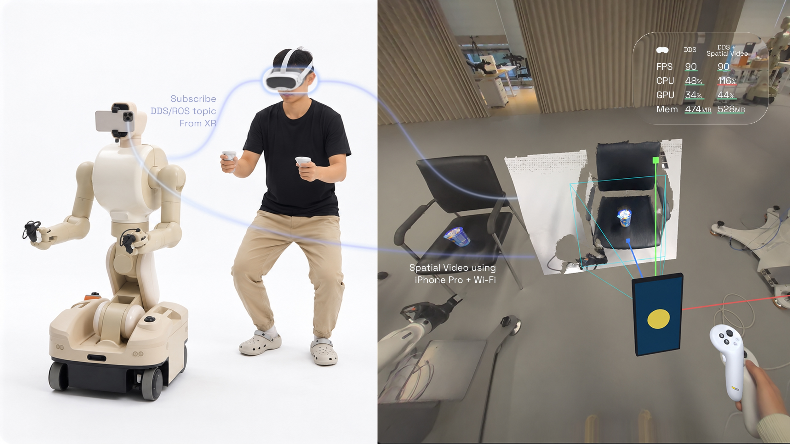
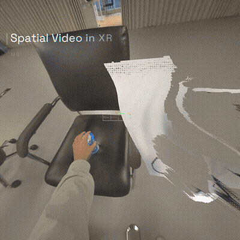
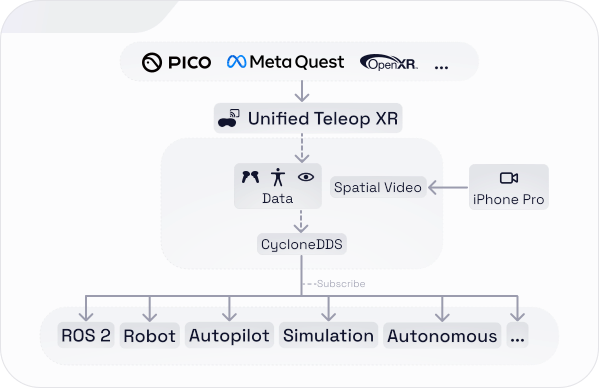
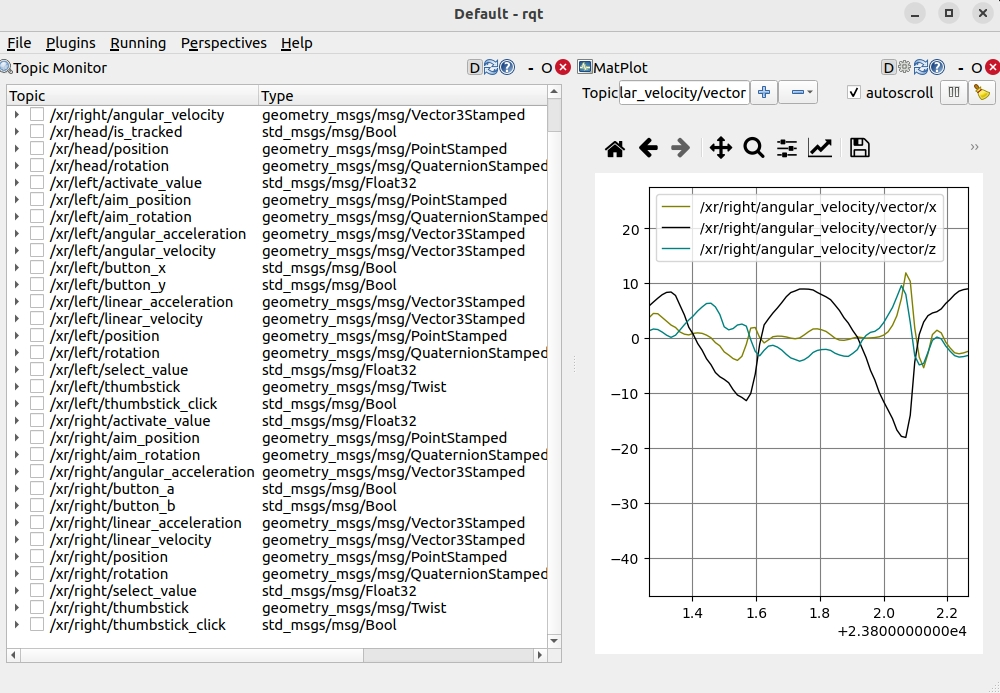
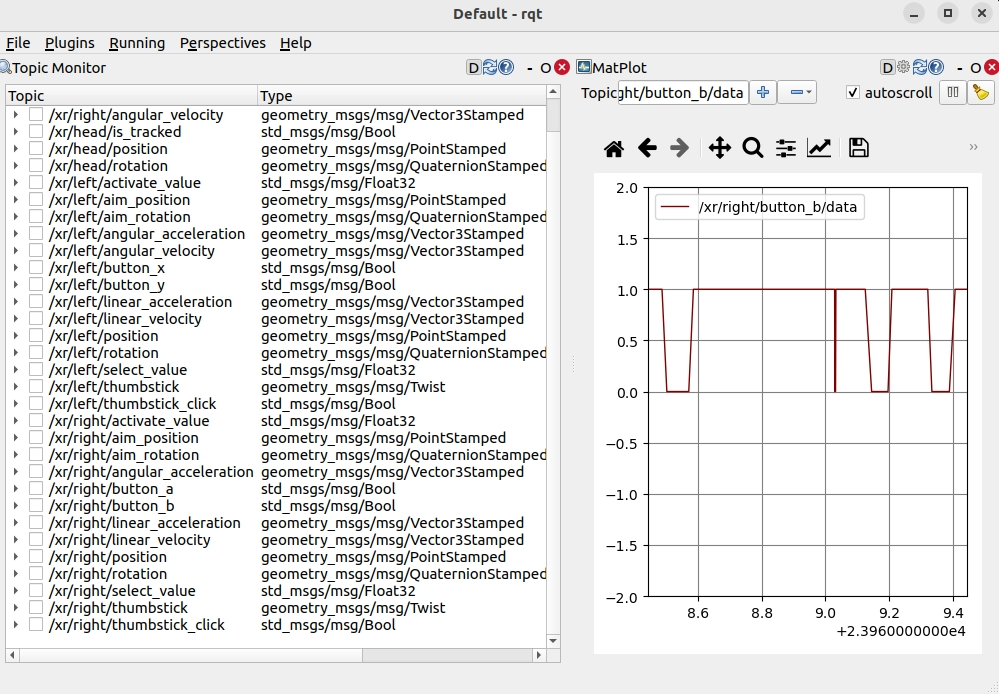

<div align="center">


**Turn your XR headset into a motion input device.**

Stream headset, controller, and body-tracking data from Meta Quest and PICO directly to ROS 2 over CycloneDDS — without building your own Unity application.

<kbd>OpenXR</kbd> <kbd>CycloneDDS</kbd> <kbd>ROS 2</kbd>

<table align="center">
  <tr>
    <td></td>
    <td></td>
  </tr>
</table>

<p>
  <a href="#quick-start">Quick Start ↗</a> ·
  <a href="#architecture">Architecture ↗</a> ·
  <a href="#data">Data &amp; Topics ↗</a> ·
  <a href="#gpu-reconstructed-spatial-video">Spatial Video ↗</a> ·
  <a href="#supported-devices">Devices ↗</a> ·
  <a href="./README_CN.md">中文 ↗</a>
</p>
</div>

> The XR → CycloneDDS → ROS 2 path has been validated with a CycloneDDS-based ROS 2 receiver. Stable standalone APK releases for Meta Quest and PICO are planned. UTXR (Unified Teleop XR) is an open-source Unity toolkit that enables developers to stream tracked motion data to ROS2 systems with minimal setup. It streams pose, velocity, acceleration, and interaction data using OpenXR and CycloneDDS. It has been used for robot teleoperation, robotic-arm manipulation, remote assistance, HRI research, egocentric data collection, and deep-learning workflows.

<a id="quick-start"></a>
## Quick Start

1. Install the **Meta Quest** or **PICO** APK from this repository's **Releases**.
2. Launch **Unified Teleop XR** on the headset.
3. Connect the headset and ROS 2/DDS receiver to the same reachable network. DDS discovery and traffic must be permitted by your network configuration.
4. Discover and subscribe to XR topics.

Example commands on a ROS 2 system with `rmw_cyclonedds_cpp` installed:

```bash
export RMW_IMPLEMENTATION=rmw_cyclonedds_cpp

ros2 topic list
ros2 topic echo /xr/head/position/
```

**If you cannot see the topics:** Ensure the headset and receiver are on the same local network with multicast enabled, and verify that `rmw_cyclonedds_cpp` is configured.

<a id="why-unified-teleop-xr"></a>
## Why Unified Teleop XR?

Robot developers should not need to build a Unity project just to read a headset's pose, controllers, or tracked body data.

| You want to… | UTXR is designed to… |
| --- | --- |
| Get XR tracking into ROS 2 | Publish subscribable XR topic streams from the headset |
| Skip XR app development | Let receivers use a prebuilt Quest/PICO APK rather than a Unity project |
| Avoid a separate ROS–TCP bridge | Publish with CycloneDDS directly in the verified setup |
| Reuse a robot-side input pipeline | Keep topic structure consistent across supported devices, subject to available sensors |
| Handle imperfect tracking more deliberately | Expose tracking validity and offer optional Safeguard post-processing |

No Unity editor, ROS–TCP bridge, or custom ROS 2 packages required. The receiver only needs standard ROS 2 message packages:
- `builtin_interfaces`
- `geometry_msgs`
- `sensor_msgs`
- `std_msgs`

<a id="architecture"></a>
## How It Works

A robot, ROS 2 node, simulator, or native DDS application on the same network can subscribe to the published data directly.



<a id="data--topics"></a>
## Data

### Raw Output

<details>
<summary><b>Head</b></summary>
<pre>
/xr/head/is_tracked                         std_msgs/msg/Bool<br>/xr/head/position                           geometry_msgs/msg/PointStamped<br>/xr/head/rotation                           geometry_msgs/msg/QuaternionStamped
</pre>
</details>

<details>
<summary><b>Left / Right Hand</b></summary>
<pre>
/xr/left/is_tracked                         std_msgs/msg/Bool<br>/xr/left/position                           geometry_msgs/msg/PointStamped<br>/xr/left/rotation                           geometry_msgs/msg/QuaternionStamped<br>/xr/left/linear_velocity                    geometry_msgs/msg/Vector3Stamped<br>/xr/left/angular_velocity                   geometry_msgs/msg/Vector3Stamped<br>/xr/left/linear_acceleration                geometry_msgs/msg/Vector3Stamped<br>/xr/left/angular_acceleration               geometry_msgs/msg/Vector3Stamped<br>/xr/right/is_tracked                        std_msgs/msg/Bool<br>/xr/right/position                          geometry_msgs/msg/PointStamped<br>/xr/right/rotation                          geometry_msgs/msg/QuaternionStamped<br>/xr/right/linear_velocity                   geometry_msgs/msg/Vector3Stamped<br>/xr/right/angular_velocity                  geometry_msgs/msg/Vector3Stamped<br>/xr/right/linear_acceleration               geometry_msgs/msg/Vector3Stamped<br>/xr/right/angular_acceleration              geometry_msgs/msg/Vector3Stamped
</pre>
</details>

<details>
<summary><b>Controller Input</b></summary>
<pre>
/xr/left/activate_value                     std_msgs/msg/Float32<br>/xr/left/select_value                       std_msgs/msg/Float32<br>/xr/left/thumbstick                         geometry_msgs/msg/Twist<br>/xr/left/thumbstick_click                   std_msgs/msg/Bool<br>/xr/left/primary_button                     std_msgs/msg/Bool<br>/xr/left/secondary_button                   std_msgs/msg/Bool<br>/xr/right/activate_value                    std_msgs/msg/Float32<br>/xr/right/select_value                      std_msgs/msg/Float32<br>/xr/right/thumbstick                        geometry_msgs/msg/Twist<br>/xr/right/thumbstick_click                  std_msgs/msg/Bool<br>/xr/right/primary_button                    std_msgs/msg/Bool<br>/xr/right/secondary_button                  std_msgs/msg/Bool
</pre>
</details>

<details>
<summary><b>Hand Joints</b></summary>
<pre>
[To Be Done]
</pre>
</details>

<details>
<summary><b>Body</b></summary>
<pre>
/xr/chest/pose                              geometry_msgs/msg/PoseStamped<br>/xr/left_shoulder/pose                      geometry_msgs/msg/PoseStamped<br>/xr/right_shoulder/pose                     geometry_msgs/msg/PoseStamped<br>/xr/left_elbow/pose                         geometry_msgs/msg/PoseStamped<br>/xr/right_elbow/pose                        geometry_msgs/msg/PoseStamped<br>/xr/hip/pose                                geometry_msgs/msg/PoseStamped<br>/xr/left_knee/pose                          geometry_msgs/msg/PoseStamped<br>/xr/right_knee/pose                         geometry_msgs/msg/PoseStamped<br>/xr/left_ankle/pose                         geometry_msgs/msg/PoseStamped<br>/xr/right_ankle/pose                        geometry_msgs/msg/PoseStamped<br>/xr/left_foot/pose                          geometry_msgs/msg/PoseStamped<br>/xr/right_foot/pose                         geometry_msgs/msg/PoseStamped
</pre>
</details>

<details>
<summary><b>Eyes</b></summary>
<pre>
/xr/eyes/is_tracked                         std_msgs/msg/Bool<br>/xr/eyes/gaze_position                      geometry_msgs/msg/PointStamped<br>/xr/eyes/gaze_rotation                      geometry_msgs/msg/QuaternionStamped
</pre>
</details>

<details>
<summary><b>Interaction</b></summary>
<pre>
/xr/left/aim_position                       geometry_msgs/msg/PointStamped<br>/xr/left/aim_rotation                       geometry_msgs/msg/QuaternionStamped<br>/xr/right/aim_position                      geometry_msgs/msg/PointStamped<br>/xr/right/aim_rotation                      geometry_msgs/msg/QuaternionStamped<br>/xr/left/select                             std_msgs/msg/Bool<br>/xr/right/select                            std_msgs/msg/Bool<br>/xr/left/select_value                       std_msgs/msg/Float32<br>/xr/right/select_value                      std_msgs/msg/Float32<br>/xr/left/activate                           std_msgs/msg/Bool<br>/xr/right/activate                          std_msgs/msg/Bool<br>/xr/left/activate_value                     std_msgs/msg/Float32<br>/xr/right/activate_value                    std_msgs/msg/Float32<br>/xr/left/ui_press                           std_msgs/msg/Bool<br>/xr/right/ui_press                          std_msgs/msg/Bool<br>/xr/left/ui_scroll                          geometry_msgs/msg/Vector3<br>/xr/right/ui_scroll                         geometry_msgs/msg/Vector3
</pre>
</details>

<div style="display:flex; gap:10px;">
  
  
</div>

### Safeguard Mode

Safeguard mode applies safety post-processing to raw OpenXR input data, primarily the left and right controller/hand poses. It is designed to reduce unsafe or invalid output when:

- Controller or hand tracking is lost during operation.
- A controller is dropped to the floor.
- Hand/controller motion exceeds a configured human-motion limit.
- A controller is left stationary somewhere and should no longer be treated as being held.

<a id="video"></a>
## GPU-Reconstructed Spatial Video

An iPhone Pro RGB-D stream can be transmitted over Wi-Fi and reconstructed as spatial video for point-cloud or mesh visualization. Reconstruction runs in GPU compute shaders.

Place an iPhone Pro at the remote site to share a spatial view of the environment and preserve a sense of distance between the camera and surrounding objects. This can improve spatial awareness during teleoperation.

This input source is dependent on the [Record3D App](https://record3d.app/) by Marek Simonik. Wi-Fi transmit is a paid feature on this iOS App. To use this feature on UTXR, you have to purchase this feature on the [App Store](https://apps.apple.com/us/app/record3d-3d-videos/id1477716895?ls=1). 

<div align="center">
  
</div>

<a id="devices--compatibility"></a>
## Supported Devices

- Meta Quest 3
- Meta Quest 3S
- Meta Quest Pro
- Meta Quest 2
- PICO 4 Ultra
- PICO 4 / PICO 4 Pro / Enterprise

<details><summary>More On The Way</summary>
PCVR<br>
Meta VR Glasses<br>
PICO Space Pro<br>
SteamVR<br>
HTC VIVE Focus<br>
HTC VIVE XR Elite<br>
Valve Index<br>
HTC VIVE Pro / Pro 2<br>
PS VR2<br>
</details>

For questions, suggestions, or support, open an issue or email [rob.bingru.li@outlook.com](mailto:rob.bingru.li@outlook.com).
