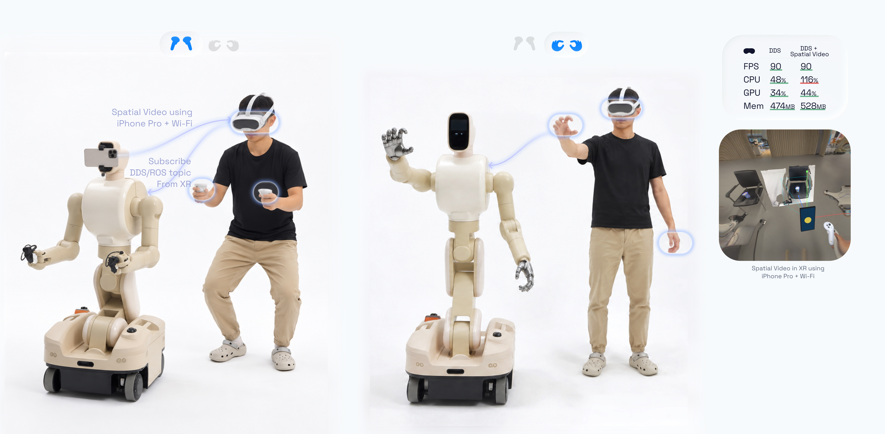
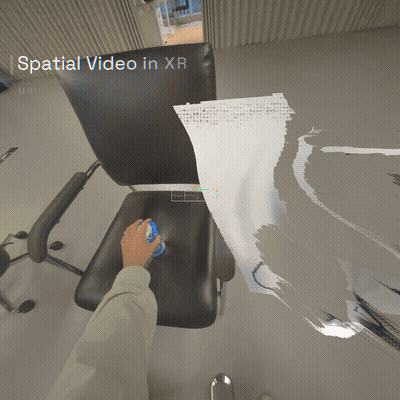
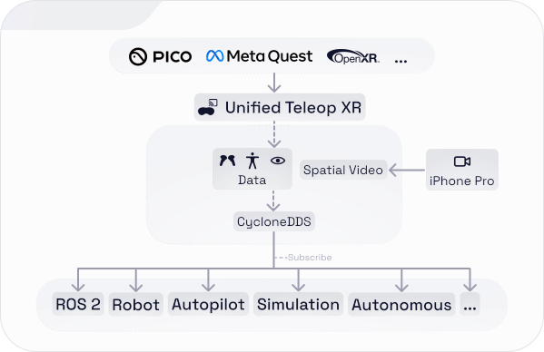
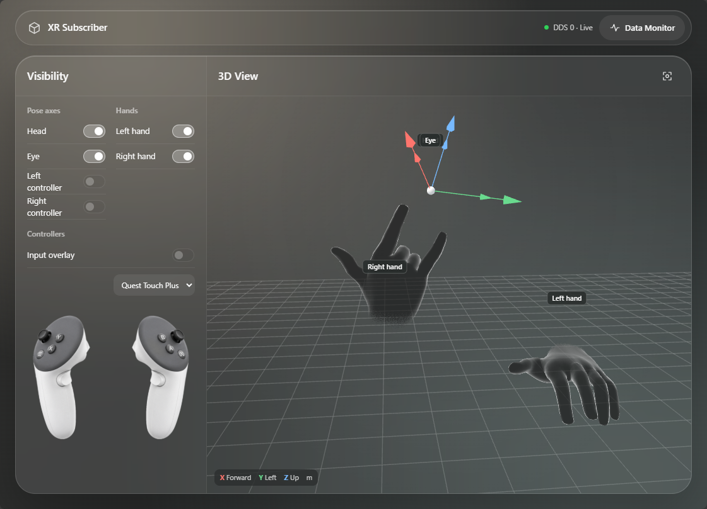
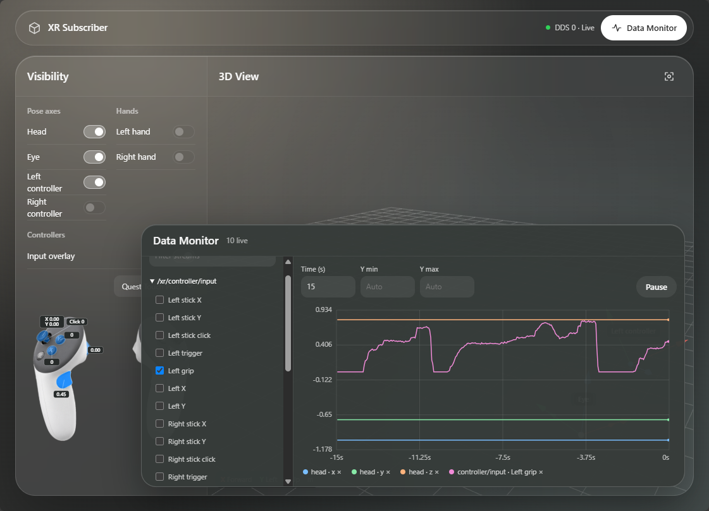

<div align="center">


**让你的 XR 头显成为运动输入设备。**

通过 CycloneDDS 将 Meta Quest 和 PICO 的头、眼、手部、控制器和身体追踪数据直接传输到 ROS 2，无需自行构建 Unity 应用。

<kbd>OpenXR</kbd> <kbd>CycloneDDS</kbd> <kbd>ROS 2</kbd> <kbd>Unity</kbd>

<table align="center">
  <tr>
    <td></td>
    <td></td>
  </tr>
</table>

<p>
  <a href="#quick-start">快速开始 ↗</a> ·
  <a href="#architecture">工作原理 ↗</a> ·
  <a href="#data">数据接口 ↗</a> ·
  <a href="#gpu-reconstructed-spatial-video">空间视频 ↗</a> ·
  <a href="#supported-devices">支持设备 ↗</a> ·
  <a href="./README.md">English ↗</a>
</p>
</div>

> XR → CycloneDDS → ROS 2 链路已使用基于 CycloneDDS 的 ROS 2 接收端验证。计划为 Meta Quest 和 PICO 发布可独立运行的稳定版 APK。UTXR（Unified Teleop XR）是开源 Unity 工具包，只需简单配置，即可通过 OpenXR 和 CycloneDDS 向 ROS 2 传输位姿、速度和交互数据。它已用于机器人遥操作、机械臂操作、远程协助、人机交互（HRI）研究、第一视角数据采集和深度学习工作流。

<a id="quick-start"></a>
## 快速开始

1. 从本仓库的 **Releases** 页面下载安装 **Meta Quest** 或 **PICO** 的 APK 安装包。
2. 在头显中启动 **Unified Teleop XR**。
3. 将头显和 ROS 2/DDS 接收端连接到同一个可达局域网。网络配置必须允许 DDS 发现与通信流量。
4. 在 Unified Teleop XR 应用中填写接收端的 IPv4 地址，然后开启 **数据发布（Data Publish）**。
5. 在接收端发现并订阅 XR 话题。

<details>
<summary>ROS 2 示例命令</summary>

在已安装 `rmw_cyclonedds_cpp` 的 ROS 2 系统上的示例命令：

```bash
export RMW_IMPLEMENTATION=rmw_cyclonedds_cpp

ros2 topic list
ros2 topic echo /xr/head/pose
```

**如果看不到话题**，请确认头显和接收端位于同一局域网、网络允许组播，且 `rmw_cyclonedds_cpp` 已正确配置。

</details>

<a id="why-unified-teleop-xr"></a>
## 为什么选择 Unified Teleop XR？

机器人开发者不应该为了读取头显位姿、手柄或身体追踪数据，而专门去构建 Unity 工程。

| 你的目标需求 | UTXR 的设计实现 |
| --- | --- |
| 将 XR 追踪接入 ROS 2 | 从头显直接发布可订阅的 XR 话题数据流 |
| 跳过 XR 应用开发 | 直接在头显上使用预编译的 Quest/PICO APK，无需构建 Unity 工程 |
| 免除额外的 ROS–TCP 桥接 | 在经过验证的环境中直接通过 CycloneDDS 发布通信 |
| 跨硬件复用机器人输入管线 | 在支持的不同设备间保持一致的话题结构（取决于可用传感器） |
| 更加从容地应对追踪异常 | 暴露追踪有效性标志，并提供可选的 Safeguard 安全后处理 |

无需 Unity 编辑器、ROS–TCP 桥接程序或自定义 ROS 2 消息包。接收端只需安装标准的 ROS 2 基础消息包：
- `builtin_interfaces`
- `geometry_msgs`
- `sensor_msgs`
- `std_msgs`

<a id="architecture"></a>
## 工作原理

同一网络中的机器人、ROS 2 节点、仿真器或原生 DDS 应用程序均可直接订阅发布的数据。



<a id="data"></a>
<a id="data--topics"></a>
## 数据接口

### 原始输出

<details>
<summary><b>头部追踪</b></summary>

<pre>
/xr/head/pose                                 geometry_msgs/msg/PoseStamped
/xr/head/velocity                             geometry_msgs/msg/TwistStamped
/xr/head/tracking_state                       std_msgs/msg/UInt32
</pre>

</details>

<details>
<summary><b>眼动追踪</b></summary>

<pre>
/xr/eye/pose                                  geometry_msgs/msg/PoseStamped
/xr/eye/tracking_state                        std_msgs/msg/UInt32
</pre>

</details>

<details>
<summary><b>左右手柄追踪（仅 Controller 模式）</b></summary>

<pre>
/xr/left/controller_pose                      geometry_msgs/msg/PoseStamped
/xr/left/controller_velocity                  geometry_msgs/msg/TwistStamped
/xr/left/controller_tracking_state            std_msgs/msg/UInt32
/xr/right/controller_pose                     geometry_msgs/msg/PoseStamped
/xr/right/controller_velocity                 geometry_msgs/msg/TwistStamped
/xr/right/controller_tracking_state           std_msgs/msg/UInt32
</pre>

</details>

<details>
<summary><b>手柄输入 Joy（仅 Controller 模式）</b></summary>

<pre>
/xr/controller/input                          sensor_msgs/msg/Joy
</pre>

`axes` 包含 8 个 float32 值。

<pre>
/xr/controller/input/axes[0]                      左摇杆 X
/xr/controller/input/axes[1]                      左摇杆 Y
/xr/controller/input/axes[2]                      左扳机
/xr/controller/input/axes[3]                      左握持
/xr/controller/input/axes[4]                      右摇杆 X
/xr/controller/input/axes[5]                      右摇杆 Y
/xr/controller/input/axes[6]                      右扳机
/xr/controller/input/axes[7]                      右握持
</pre>

`buttons` 包含 6 个 int32 值，`1` 表示按住，`0` 表示松开。至少有一项输入可用时发布 Joy，缺失输入的槽位保持默认值 `0`。

<pre>
/xr/controller/input/buttons[0]                   X 键（左主按键）
/xr/controller/input/buttons[1]                   Y 键（左次按键）
/xr/controller/input/buttons[2]                   A 键（右主按键）
/xr/controller/input/buttons[3]                   B 键（右次按键）
/xr/controller/input/buttons[4]                   左摇杆按下
/xr/controller/input/buttons[5]                   右摇杆按下
</pre>

</details>

<details>
<summary><b>手部追踪（仅 Hand 模式）</b></summary>

<pre>
/xr/left/hand_joints                          std_msgs/msg/Float32MultiArray
/xr/left/hand_velocity                        geometry_msgs/msg/TwistStamped
/xr/left/hand_tracking_state                  std_msgs/msg/UInt32
/xr/right/hand_joints                         std_msgs/msg/Float32MultiArray
/xr/right/hand_velocity                       geometry_msgs/msg/TwistStamped
/xr/right/hand_tracking_state                 std_msgs/msg/UInt32
</pre>

每只手 208 个 float32，只包含 26 个关节记录。以下为左手，右手将 `left` 换为 `right`。

<pre>
/xr/left/hand_joints/data[0]                      Wrist 追踪状态
/xr/left/hand_joints/data[1]                      Wrist 位置 x
/xr/left/hand_joints/data[2]                      Wrist 位置 y
/xr/left/hand_joints/data[3]                      Wrist 位置 z
/xr/left/hand_joints/data[4]                      Wrist 旋转 qx
/xr/left/hand_joints/data[5]                      Wrist 旋转 qy
/xr/left/hand_joints/data[6]                      Wrist 旋转 qz
/xr/left/hand_joints/data[7]                      Wrist 旋转 qw
</pre>

每个关节占 8 个值：`追踪状态、x、y、z、qx、qy、qz、qw`。第 i 个关节从 `data[8*i]` 开始。

<pre>
i = 0                                            Wrist
i = 1                                            Palm
i = 2…5                                          Thumb
i = 6…10                                         Index
i = 11…15                                        Middle
i = 16…20                                        Ring
i = 21…25                                        Little
</pre>

手指顺序：Metacarpal、Proximal、Intermediate、Distal、Tip；Thumb 没有 Intermediate。关节状态的 Pose 位为 `2`，无效位姿清零。数组无时间戳。

整手状态通过 `hand_tracking_state/data` 单独发送；线速度和角速度通过 `hand_velocity/twist/linear` 与 `hand_velocity/twist/angular` 单独发送。速度关闭时，整手状态不采集速度有效性位。

</details>

<details>
<summary><b>身体追踪</b></summary>

待补充。

</details>

<details>
<summary>其它说明</summary>

带 Header 的消息使用 `frame_id = xr_tracking`。坐标转换为 X 轴朝前、Y 轴朝左、Z 轴朝上，位置单位为米。

`tracking_state.data` 是 Unity `InputTrackingState` 位掩码：位置 `1`、旋转 `2`、线速度 `4`、角速度 `8`、线加速度 `16`、角加速度 `32`。位姿需位置和旋转均有效，速度需线速度和角速度均有效。输入不可用时对应消息会跳过。

QoS：位姿、速度和关节数组为 BestEffort / Volatile / KeepLast(1)；追踪状态为 Reliable / TransientLocal / KeepLast(1)；Joy 为 Reliable / Volatile / KeepLast(10)。

</details>

<div style="display:flex; gap:10px;">
  
  
</div>

上图展示了 [XR Subscriber](./CycloneDDS/subscriber/) 接收 UTXR 的 DDS 消息时的界面。这个调试工具通过 C 插件订阅消息。

**手柄模式与手部追踪模式互斥。** 两种模式共用头部和眼动话题。切换模式会停止发布，需手动重新开启。

### Safeguard 安全模式

Safeguard 模式会对原始 OpenXR 输入数据进行安全后处理，主要作用于左右控制器/手部姿态。用于减少以下情况下的不安全或无效输出：

- 操作过程中控制器或手部追踪丢失。
- 控制器掉落到地面。
- 手部/控制器运动超过设定的人体运动限制。
- 控制器被静止放置在某处，不再被判定为手持状态。

<a id="gpu-reconstructed-spatial-video"></a>
<a id="video"></a>
## GPU 重建空间视频

iPhone Pro 的 RGB-D 数据流可通过 Wi-Fi 传输，并在 XR 中重建为空间视频，以点云或三维网格（Mesh）形式进行可视化渲染。重建计算完全在 GPU Compute Shader 中运行。

将 iPhone Pro 放置在远程端，可共享具有真实空间尺度感的环境视角，保留相机与周围物体之间的距离感。这能显著提升遥操作过程中的空间环境感知能力。

该输入源依赖 Marek Simonik 开发的 [Record3D App](https://record3d.app/)。Wi-Fi 传输是该 iOS 应用中的付费功能。要在 UTXR 中使用此功能，需要在苹果应用商店（[App Store](https://apps.apple.com/us/app/record3d-3d-videos/id1477716895?ls=1)）购买该功能。

<div align="center">
  
</div>

<a id="supported-devices"></a>
<a id="devices--compatibility"></a>
## 支持设备

- Meta Quest 3
- Meta Quest 3S
- Meta Quest Pro
- Meta Quest 2
- PICO 4 Ultra
- PICO 4 / PICO 4 Pro / Enterprise

<details><summary>后续计划支持</summary>
PCVR<br>
Meta VR 眼镜<br>
PICO Space Pro<br>
SteamVR<br>
HTC VIVE Focus<br>
HTC VIVE XR Elite<br>
Valve Index<br>
HTC VIVE Pro / Pro 2<br>
PS VR2<br>
</details>

如有问题、建议或需要支持，请在仓库提交 Issue，或发送邮件至 [rob.bingru.li@outlook.com](mailto:rob.bingru.li@outlook.com)。
